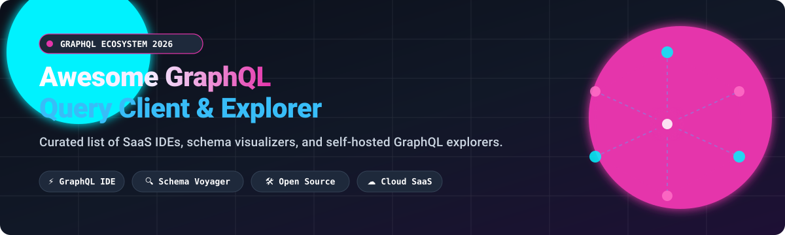
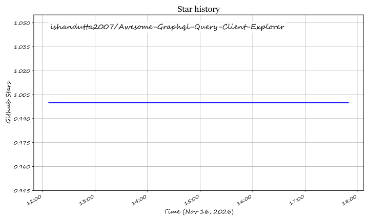

  

# 🚀 Awesome GraphQL Query Client & Explorer

  <b>A curated catalog of premier GraphQL IDEs, schema visualizers, query clients, and API exploration tools.</b> 
  <i>Covering production SaaS platforms, self-hosted developer tools, and open-source GitHub utilities.</i> 
  <b>Last updated: March 2026</b>

---

## 📌 Overview & Ecosystem Scope

Welcome to **Awesome-Graphql-Query-Client-Explorer** — an authoritative, SEO-indexed, community-maintained collection of the best tools for interacting with GraphQL APIs. Whether you are debugging queries, inspecting complex type relationships, performing security audits, or collaborating on operation collections across development teams, this repository categorizes the top developer tools across both enterprise **SaaS platforms** and **open-source software**.

### 🎯 Key Highlights:
- ⚡ **Official & Canonical IDEs**: [GraphiQL](https://github.com/graphql/graphiql) reference environment with the latest query builder workflows.
- 🌐 **Cross-Platform & Offline-First Clients**: [Bruno](https://github.com/usebruno/bruno) and [Altair GraphQL Client](https://github.com/altair-graphql/altair) with Git sync and multi-window execution.
- 🗺️ **Interactive Schema Visualizers**: [GraphQL Voyager](https://github.com/APIs-guru/graphql-voyager) for navigating graph relations as interactive flowcharts.
- 🛡️ **API Security & Pentesting**: [InQL Scanner](https://github.com/doyensec/inql) for automated introspection checks and security evaluations.
- 🏢 **Enterprise Federation & Observability**: [Apollo GraphOS Studio](https://www.apollographql.com/docs/studio/) and [Postman GraphQL Client](https://www.postman.com/) for team collections and cloud sync.

---

## 📑 Table of Contents
- [📊 Sector Overview & Market Dynamics](#-sector-overview--market-dynamics)
- [☁️ SaaS & Hosted Platforms](#️-saas--hosted-platforms)
- [💻 Open-Source GitHub Projects](#-open-source-github-projects)
- [🤝 How to Contribute](#-how-to-contribute)
- [⭐ Star History](#-star-history)
- [💖 Support & Sponsorship](#-support--sponsorship)
- [⚠️ Disclaimer](#️-disclaimer)

---

## 📊 Sector Overview & Market Dynamics

The global GraphQL API management and client tooling sector is estimated at **$1.8 billion to $2.2 billion** (growing at ~25% CAGR as part of the broader $9B+ API management market). 

The market dynamics exhibit a **hybrid structure**: while the overarching API management plane is moderately concentrated around hyperscalers (AWS, Azure, Google Cloud/Apigee), the specialized GraphQL IDE, schema exploration, and federation client layer remains **fragmented and highly competitive**, driven by fast-moving developer-first platforms and vibrant open-source communities.

---

## ☁️ SaaS & Hosted Platforms

| Product | Company Size / Valuation | Pricing (Starting) | Free Tier / Trial Limits | Description |
|---------|--------------------------|-------------------|--------------------------|-------------|
| **[Postman GraphQL Client](https://www.postman.com/)** | **$5.6B Valuation** (~$300M ARR) | **$9/user/month** (Solo, billed annually) | **Free forever**: Strictly 1 user (solo), unlimited collection runs, unlimited manual mock server calls, no team workspaces | 🚀 GraphQL query and schema inspection support within Postman's API platform. Write queries, manage variables, and integrate with collections and environments. |
| **[Insomnia (Kong)](https://insomnia.rest/)** | **$2.0B Valuation** (~$100M+ ARR) | **$12/user/month** (Pro, billed annually) | **Free forever**: Local Scratchpad + Cloud sync, Git Sync projects capped at 3 users, 1,000 mock server requests/month | 🌙 Streamlined desktop API client with native GraphQL query autocompletion, schema inspection, and environment variable support backed by Kong. |
| **[Apollo Studio (GraphOS)](https://www.apollographql.com/docs/studio/)** | **$1.5B Valuation** (~$40M ARR) | **$5 per million requests** (Developer plan) | **Free forever**: Up to 3 users/org, rate-limited to 60 req/min on self-hosted routers, 1-day trace/metric retention | 🛰️ Cloud platform for building, querying, and securing data graphs. Features the Apollo Explorer IDE, schema registry, and operation collections. |
| **[Hasura Cloud](https://hasura.io/)** | **$1.0B Valuation** (Series C) | **$5/month per active model** (DDN Base plan) | **Free forever**: Up to 3 projects, 3M API requests/month, 100MB-1GB data passthrough, community connectors | ⚡ Cloud-managed GraphQL engine and data delivery network featuring built-in GraphiQL explorer console and instant schema exploration. |

---

## 💻 Open-Source GitHub Projects

| Project | Stars_Badge | Description |
|---------|------------|-------------|
| **[Hoppscotch](https://github.com/hoppscotch/hoppscotch)** |  | 🛸 **Open-source API development ecosystem with a built-in GraphQL client.** Self-hostable web and desktop client with syntax highlighting, auto-completion, collections, variables, headers, authentication, schema explorer, and documentation explorer. |
| **[Bruno](https://github.com/usebruno/bruno)** |  | 📁 **Fast, Git-friendly, open-source API client for REST and GraphQL.** Stores collections directly in folders on your filesystem using plain text (Bru markup language), enabling seamless version control, PR reviews, and offline-first GraphQL query execution. |
| **[Insomnia](https://github.com/Kong/insomnia)** |  | 🦉 **Leading open-source desktop API design, debugging, and testing client.** Features first-class GraphQL query building, schema documentation navigation, operation history, and environment chaining across development environments. |
| **[GraphiQL](https://github.com/graphql/graphiql)** |  | 💎 **The official reference GraphQL IDE under the GraphQL Foundation.** MIT-licensed, React-based workspace with built-in query builder, operation collections for saving and sharing queries, Tree/Table response views, schema-aware autocomplete, and real-time linting. |
| **[GraphQL Voyager](https://github.com/APIs-guru/graphql-voyager)** |  | 🗺️ **The leading open-source schema visualization tool.** Represents any GraphQL API as an interactive graph to map out data models and entity relationships. Includes type navigation, quick search, and a "Skip Relay" filter. |
| **[GraphQL Editor](https://github.com/graphql-editor/graphql-editor)** |  | 🎨 **Visual development environment and schema explorer.** Provides interactive node-based schema mapping, automatic mock generation, and query building for rapid backend and frontend GraphQL development. |
| **[Altair GraphQL Client](https://github.com/altair-graphql/altair)** |  | 🦅 **The most feature-rich cross-platform open-source GraphQL client.** Available as a desktop app, browser extension, and embeddable React/Vue/Angular component. Supports GraphQL subscriptions, query scaffolding, multi-tab workspaces, and environment variables. |
| **[Graphqurl](https://github.com/hasura/graphqurl)** |  | ⌨️ **`curl` for GraphQL with autocomplete and subscriptions.** CLI tool and lightweight server for running queries, testing subscriptions over WebSocket, and launching a local GraphiQL instance against any endpoint. |
| **[GraphiQL App](https://github.com/skevy/graphiql-app)** |  | 🖥️ **Lightweight, standalone cross-platform Electron wrapper for GraphiQL.** Enables running GraphiQL as a native desktop application with custom HTTP headers, auth tokens, and multi-endpoint profiles without browser extensions. |
| **[Firecamp](https://github.com/firecamp-dev/firecamp)** |  | 🔥 **Developer-first open-source API development tool with a dedicated GraphQL playground.** Multi-protocol support (REST, GraphQL, WebSocket) for composing queries, managing collaborative operation collections, and debugging APIs. |
| **[InQL Scanner](https://github.com/doyensec/inql)** |  | 🛡️ **Security-focused GraphQL explorer and vulnerability tester.** Generates interactive query documentation from introspection, automates query enumeration, and integrates with Burp Suite and standalone CLI workflows. |
| **[SpectaQL](https://github.com/anvilco/spectaql)** |  | 📖 **Autogenerated, static, interactive GraphQL documentation and explorer.** Produces responsive, human-readable API documentation and interactive schema exploration pages from live GraphQL schemas or SDL files. |

### 📦 Archived / Legacy Projects

| Project | Stars_Badge | Description |
|---------|------------|-------------|
| **[GraphQL Playground](https://github.com/graphql/graphql-playground)** |  | ⚠️ **Archived May 2026—not recommended for new projects.** Legacy GraphQL IDE with subscriptions, interactive docs, and collaboration. Stars_Count: ~8.8k, but OpenSSF maintained score 0/10 and unmaintained. Plan migration to GraphiQL or Altair. |

---

## 🤝 How to Contribute

Contributions, suggestions, and corrections are warmly welcomed! 🌟

1. **Fork the repository** to your GitHub account.
2. **Add or update an entry** in `README.md` following the table formatting:
   - Include project name, official URL, Stars_Badge link, concise feature overview, and proper protocol focus.
3. **Ensure factual accuracy** with verified URLs and up-to-date star and pricing details.
4. **Submit a pull request (PR)** with a clear explanation of why the tool should be listed.

---

## 📈 Star History

---

## 💖 Support & Sponsorship

If you find this curated GraphQL query client directory valuable:
- ⭐ **Star this repository** to help other engineers and developers discover it!
- 🍴 **Fork it** to customize your team's internal API tool stack.
- 📢 **Share it** on X, LinkedIn, Reddit, or developer Discord communities.
- ☕ **Support the maintainer**: Consider buying a coffee or becoming a sponsor via the [GitHub Sponsor Dashboard](https://github.com/sponsors/ishandutta2007).

---

## ⚠️ Disclaimer

- This is a **community-curated directory** created for educational and developer productivity purposes. Inclusion does not imply official endorsement.
- GraphQL clients process API credentials, bearer tokens, and sensitive data. Always enforce strict authentication, validate self-hosted deployments, and exercise caution when connecting to untrusted remote endpoints (e.g., GraphiQL versions prior to 1.4.3 contain known XSS vulnerabilities).
- **Tooling Maintenance Consideration**: **GraphQL Playground was archived in May 2026**; new architectures should standardize on **GraphiQL** (the canonical GraphQL Foundation IDE), **Altair** (cross-platform desktop/browser/embeddable UI), or **Bruno / Hoppscotch** (offline-first & multi-protocol collections).

---

  <b>Built with ❤️ for GraphQL developers, API engineers, and backend architects worldwide.</b>

## ⭐ Star History

<a href="https://star-history.com/#ishandutta2007/Awesome-Graphql-Query-Client-Explorer&Timeline" align="center">
  <picture>
    <source media="(prefers-color-scheme: dark)" srcset="assets/ishandutta2007_Awesome-Graphql-Query-Client-Explorer_growth.svg">
    
  </picture>
</a>
